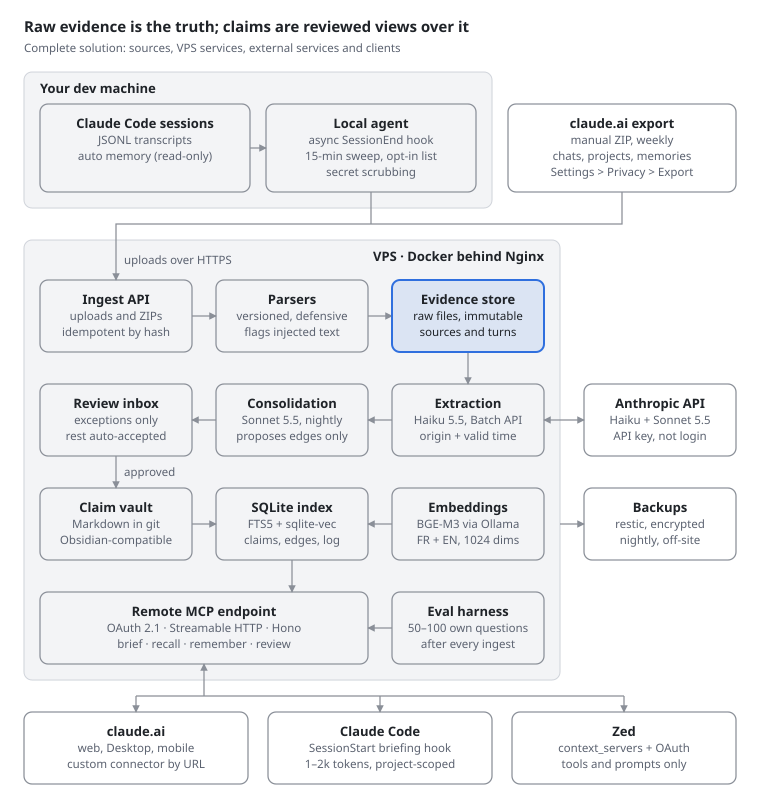
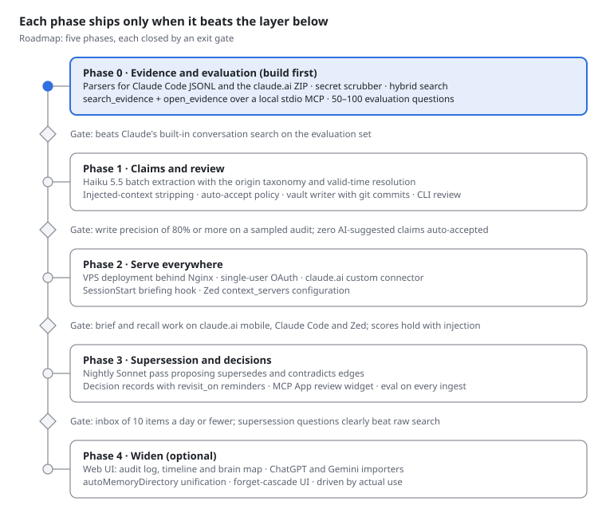

# glia — Specification

2026-10-20 · @Kylian · The project was named AI Second Brain (`ai_second_brain`, command `brain`) until 2026-10-27, when it became glia (command `glia`, npm `@galaxymak1/glia`).

## Overview

The system is a personal, self-hosted evidence ledger. It keeps every Claude conversation as immutable evidence, derives a small set of reviewed, dated and attributed claims from it, and serves both back to any MCP client. Each install serves one user. The code is source-available under the Elastic License 2.0: anyone may run, read and change it, but not offer it to others as a hosted or managed service.

**Goals**

- Capture every Claude Code session and every claude.ai export deterministically, without relying on the model choosing to save.
- Search across all Claude silos at once (claude.ai chats, projects, Claude Code sessions, Claude Code auto memory).
- Extract typed claims and decisions that record who originated them, when they became true, and what superseded them.
- Keep review to about 2 minutes a day by queuing only exceptions.
- Serve the brain from claude.ai web and mobile, Claude Code and Zed through one remote MCP endpoint.
- Prove on personal evaluation questions that each layer beats a raw-search baseline.
- Install on a fresh Linux or macOS machine in one command, without reading the source.

**Non-goals**

- Multi-user accounts or sharing within one install.
- Live capture of claude.ai chats (no legitimate path exists).
- General document RAG, web clipping or a PKM taxonomy.
- Psychological or personality inferences about the user.

**Design principles**

1. Evidence is the truth; claims are rebuildable views that point back to it.
2. Never update or delete a claim automatically; supersede it and keep the history.
3. Every claim carries its origin; Claude's suggestions never become user facts without approval.
4. Capture is deterministic; model-initiated writes are a best-effort bonus.
5. Inject little: a briefing of 1–2k tokens, scoped to the current project, with `as_of` dates.
6. Plain files and boring storage: Markdown in git, one SQLite file, no young memory framework as a dependency.

## Scope

The MVP covers ingestion of all Claude sources, typed claims with provenance and supersession, an exception-based review inbox, one remote MCP endpoint and an evaluation harness. Everything else waits until the evaluation shows a need.

| In the MVP | Out of the MVP | Why out |
| --- | --- | --- |
| Claude Code transcripts via async SessionEnd/PreCompact hook + periodic sweep | Scraping claude.ai with cookies or a browser extension | Forbidden by the Consumer Terms |
| claude.ai export ingestion (conversations, projects, memories), idempotent | Writing back into claude.ai memory | No API; lossy and filtered to work topics |
| Read-only ingestion of Claude Code auto memory | Pointing `autoMemoryDirectory` into the vault | Untested; phase 4 |
| Immutable evidence store + hybrid FR/EN search over raw turns | ChatGPT and Gemini importers | Not a Claude silo; phase 4 |
| Typed claims with origin, evidence pointer, valid time, supersession | Graph database, Graphiti, entity resolution | Unjustified at personal scale |
| Decision records with rejected options and `revisit_on` | Personality or psychological inferences | Dropped at extraction |
| Review inbox (MCP App + CLI) with auto-accept policy | Document or web-clip RAG, reading lists | Different product |
| Secret scrubbing; stripping of injected context before extraction | Multi-user, sharing, org exports | Single user by design |
| Remote MCP server with single-user OAuth; SessionStart briefing hook; Zed config | Full web app, brain map (claims as a neuron graph), mobile app | Phase 4 |
| Personal evaluation harness with baselines | Local LLM extraction; cross-encoder reranking | Until the evaluation shows a need |

Sessions in client or employer repositories are excluded by default; each project is opted in.

## Architecture

The solution has three flows: capture writes raw evidence, derivation turns evidence into reviewed claims, and serving answers every client through one MCP endpoint.



Read top to bottom. Capture is deterministic: the local agent and the export both land in the immutable evidence store. Derivation only proposes: extraction and consolidation feed the review inbox, and only approved or auto-accepted claims reach the vault. The index is rebuildable from the evidence and the vault at any time.

## Data model

The data has three layers: immutable evidence, curated claims stored as Markdown files in git, and a rebuildable SQLite index with an append-only log. Deleting the index loses nothing; it is rebuilt from the evidence and the vault.

### Evidence layer

- Raw files kept as received: claude.ai export ZIPs, Claude Code `.jsonl` transcripts, auto memory files. Stored gzip-compressed with a SHA-256 hash.
- Parsed into `sources` and `turns` tables. Parsers are versioned, so a format change means re-parsing, never data loss.

### Claim layer

One Markdown file per claim in `vault/claims/<year>/<id>.md`. The body is the statement in its original language; the frontmatter carries the metadata.

```yaml
id: clm_01JB7Q3W9K              # ULID, never reused
kind: decision                  # profile | preference | project_fact | decision | lesson | procedure
scope: project:ai-brain         # global | project:<slug> | context:<tag>
statement_lang: fr              # fr | en | mixed
# provenance
origin: user_stated             # user_stated | user_confirmed | ai_suggested | ai_inferred | external_doc | imported_memory
evidence:
  - source: cc:5f1c…            # cc:<session> | cai:<conversation uuid> | cap:<project uuid> | mem:<file>
    turn: 8e2a…                 # message uuid
    quote: "on part sur SQLite, pas Postgres"
    quote_sha256: 3b9f…
extractor: {model: claude-haiku-5-5, prompt: extract@v1, batch: msgbatch_…}
confidence: 0.86
# time (bi-temporal)
valid_from: 2026-10
valid_from_precision: month     # day | month | year | approx | unknown
valid_to: null
recorded_at: 2026-10-20T14:02:11Z
supersedes: []
superseded_by: null
status: active                  # proposed | active | superseded | retracted | rejected | expired
# review and safety
review: approved                # auto_accepted | pending | approved | edited | rejected
reviewed_at: 2026-10-20T18:40:00Z
sensitivity: normal             # normal | sensitive (never auto-accepted)
# decision-only fields
options: [{option: Postgres + pgvector, rejected_because: "RAM, ops"}, {option: SQLite}]
rationale: "zero-ops, single file, rebuildable index"
expected_outcome: {text: "index rebuild under 2 min", confidence: 0.7}
revisit_on: 2027-01-15
```

### Index and log (SQLite)

| Table | Holds | Key columns |
| --- | --- | --- |
| `sources` | One row per conversation, session or memory file | `id`, `kind`, `external_id`, `title`, `project_hint`, `cwd`, `git_remote`, `created_at`, `updated_at`, `raw_path`, `raw_sha256`, `parser_version`, `excluded` |
| `turns` | One row per message | `id`, `source_id`, `external_uuid`, `parent_uuid`, `role`, `ts`, `text`, `is_sidechain`, `is_injected`, `lang` |
| `turns_fts` / `turns_vec` | Full-text and vector indexes over turns | FTS5 `unicode61 remove_diacritics 2`; sqlite-vec, 1024 dims |
| `claims` | Mirror of the claim frontmatter for querying | all frontmatter fields + `file_path`, `file_sha` |
| `claims_fts` / `claims_vec` | Indexes over claim statements | same as turns |
| `edges` | Links between claims | `src`, `dst`, `type` (supersedes, contradicts, refines, about, derived_from), `valid_from`, `valid_to` |
| `retrievals` | Which claim was served to which session, when | `claim_id`, `client`, `session_ref`, `ts` |
| `proposals` | Review inbox items | `id`, `kind`, `claim_id`, `reason`, `created_at`, `expires_at`, `state` |
| `log` | Append-only audit trail, mirrored to `log.md` | `ts`, `actor` (user, extractor, consolidator, `mcp:<client>`), `action`, `claim_id`, `payload` |
| `jobs` | Batch and sweep job state | `id`, `type`, `state`, `batch_id`, `started_at`, `finished_at` |

Every vector row stores the embedding model name and dimension, so a model change triggers a re-embed instead of mixing spaces.

## Ingestion

Four sources feed the evidence layer; two are deterministic and form the backbone, two are best-effort. Every ingest is idempotent: re-running it on the same input changes nothing.

| Source | Trigger | Path | Reliability |
| --- | --- | --- | --- |
| Claude Code transcripts | `SessionEnd` and `PreCompact` hooks (`async: true`) + sweep every 15 min | `~/.claude/projects/<project>/<session>.jsonl` → local spool → upload to VPS | Deterministic |
| claude.ai export | Manual export (weekly reminder), ZIP uploaded via CLI or endpoint | `conversations.json`, `projects.json`, `memories.json` | Deterministic, days old |
| Claude Code auto memory | Same sweep as transcripts, read-only | `~/.claude/projects/<project>/memory/*.md` | Deterministic |
| `remember` / `record_decision` MCP calls | Claude calls the tool mid-conversation | Remote MCP endpoint | Best-effort |

### Local agent (on the dev machine)

1. The hook copies `transcript_path` into a spool folder and returns immediately, staying within the 1.5 s `SessionEnd` budget.
2. A systemd user timer sweeps `~/.claude/projects/**/*.jsonl` every 15 minutes to catch crashed sessions.
3. The uploader skips projects not on the opt-in list, scrubs secrets, and sends new or changed files to the VPS with their SHA-256.
4. Set `cleanupPeriodDays` to 365 so transcripts outlive any upload outage.

### Server-side parsing

1. Store the raw file, then parse with a defensive, versioned parser: unknown fields are kept, unknown line types skipped.
2. Claude Code: rebuild the message tree from `parentUuid`; mark `isSidechain` turns; drop metadata lines.
3. claude.ai: locate files by suffix (exports may be split across ZIPs); upsert conversations by `uuid` + `updated_at`; attach chats to projects by manual tag, since the export carries no project link.
4. Mark injected content (`<system-reminder>` blocks, hook `additionalContext`, recalled claim IDs) as `is_injected`, so it is searchable but never extracted again.
5. Detect language per turn (fr, en, mixed) and embed turns into the index.

## Extraction and consolidation

Extraction runs nightly through the Batch API with Claude Haiku 5.5 and only ever proposes claims; consolidation runs with Sonnet 5.5 and only ever proposes edges. Neither step edits or deletes an existing claim.

### Nightly extraction (Haiku 5.5, Batch API)

1. Select sources with new or changed turns since the last run; skip excluded projects and `is_injected` turns.
2. Chunk each source into requests under 100k tokens, to stay in Haiku's cheaper price tier.
3. Prompt for structured output: claims with `kind`, `scope`, statement in the original language, `origin`, evidence turn IDs with verbatim quote, temporal expressions and confidence.
4. Resolve relative time ("since March", "I used to", "next week") against the message timestamp, not the ingest time; set `valid_from_precision`.
5. Validate: the quote must exist verbatim in the cited turn, or the claim is dropped. Drop psychological or personality inferences.
6. Deduplicate against active claims by embedding similarity plus statement match; a near-duplicate adds evidence to the existing claim instead of creating one.
7. Apply the auto-accept policy (Review inbox section); write accepted claims to the vault and commit to git; queue the rest as proposals.

### Origin rules

| Origin | Assigned when | Auto-accept |
| --- | --- | --- |
| `user_stated` | The user says it in their own turn | Yes, if non-sensitive and not conflicting |
| `user_confirmed` | Claude proposes it and the user explicitly agrees | Yes, same conditions |
| `ai_suggested` | Claude proposes it; the user does not confirm | Never |
| `ai_inferred` | Derived by the extractor, not stated by anyone | Never |
| `external_doc` | Comes from pasted or uploaded content | Never |
| `imported_memory` | Comes from `memories.json` or auto memory | Never; queued once on first import |

### Nightly consolidation (Sonnet 5.5)

1. For each new claim, retrieve the top related active claims in the same scope.
2. Ask for candidate edges only: `supersedes`, `contradicts`, `refines`.
3. Every `supersedes` or `contradicts` edge becomes a proposal; nothing changes status until it is approved.
4. On approval, the old claim gets `status: superseded`, `valid_to` and `superseded_by`; the new one gets `supersedes`. Both files stay in the vault.

### Cost budget

At about 300 conversations a month, extraction costs roughly $0.45 batched and consolidation about $2.25. Total LLM spend stays under $5 a month.

## Review inbox

The inbox holds only exceptions and targets about 10 items and 2 minutes a day. Everything else is auto-accepted, logged and randomly audited.

### Routing policy

- **Auto-accepted:** `user_stated`, `user_confirmed`, `imported_memory` and `external_doc` claims, decisions included, that are non-sensitive and do not conflict with an active claim. 10% are resurfaced at random for audit.
- **Queued (real risks only):** `ai_suggested` and `ai_inferred` claims; every supersession or contradiction proposal; everything marked sensitive.
- **Expired:** proposals unreviewed after 30 days move to `expired` and leave the inbox, so it never becomes a backlog.

### Item card

Each item shows the proposed statement, its origin, scope and validity, the reason it was queued, the verbatim quote with a link to the evidence, and for supersession a side-by-side view of old and new claim.

### Actions

| Key | Action | Effect |
| --- | --- | --- |
| `a` | Accept | `review: approved`, `status: active`, file written and committed |
| `e` | Edit | Choose from suggested rewordings or edit inline, then accept |
| `m` | Merge | Attach as evidence to an existing claim instead of creating a new one |
| `r` | Reject | `review: rejected`; the extractor will not propose the same statement again |
| `s` | Snooze | Hide for 7 days |

### Surfaces

- **MCP App** widget inside claude.ai web and Desktop, opened by the `review` tool.
- **CLI** (`glia review`) for keyboard-only triage in the terminal.
- **Obsidian** for browsing and editing the vault directly; edits are picked up on the next index sync.

### Health metrics

Track rejection rate and median decision time per week. A rejection rate near zero means auto-accept can be widened, or that items are being rubber-stamped.

## Serving

One remote MCP endpoint serves every client, and a `SessionStart` hook gives Claude Code a deterministic briefing. Tools return results well under 25k tokens and are annotated `readOnlyHint` or `destructiveHint`.

### MCP tools

| Tool | Type | Purpose |
| --- | --- | --- |
| `brief(scope?, budget_tokens=1500)` | read-only | Compact briefing: profile, active project claims, open decisions, each with `as_of` dates. Also exposed as an MCP prompt for Zed |
| `recall(query, scope?, as_of?, include_superseded=false, limit=8)` | read-only | Hybrid search over claims; returns statement, origin, validity and evidence IDs |
| `search_evidence(query, source_kind?, from?, to?)` | read-only | Hybrid search over raw turns across all Claude sources |
| `open_evidence(id, window=6)` | read-only | The cited turn with surrounding context |
| `remember(statement, kind, scope, origin)` | write | Creates a claim or a proposal per the routing policy |
| `record_decision(title, options, chosen, rationale, revisit_on?, supersedes?)` | write | Creates a decision record, always queued |
| `review()` | read-only, MCP App | Renders the inbox widget; plain-text fallback elsewhere |
| `resolve(proposal_id, action, edit?)` | write | Applies a review action; never deletes |
| `forget(target_id, cascade=true)` | destructive | Retracts a claim, or excludes a source and cascades to claims derived only from it |

### Retrieval

1. Run FTS5 (BM25) and sqlite-vec queries in parallel, then fuse with reciprocal rank fusion (k = 60).
2. Filter by scope and validity: superseded claims are hidden unless `include_superseded` or `as_of` asks for them.
3. Log every served claim in `retrievals`, so recalled content can be recognised when it comes back in a transcript.

### Claude Code briefing hook

A `SessionStart` hook resolves the project from `cwd` or the git remote, calls `brief`, and returns at most 1–2k tokens as `additionalContext`. The injected block is tagged so ingestion marks it `is_injected`.

### Clients

| Client | Connection | Notes |
| --- | --- | --- |
| claude.ai web, Desktop, mobile | Custom connector added by URL | Add on web or Desktop first; mobile then works through Anthropic's cloud |
| Claude Code | Picks up claude.ai connectors, or `claude mcp add` | Plus the `SessionStart` hook |
| Zed | `context_servers` with the same URL + OAuth | Tools and prompts only, no resources |
| Claude Code inside Zed | `claude-agent-acp` adapter | Configure the server in one place to avoid duplicate tools |

## Security, privacy and terms

The endpoint will hold the user's entire Claude history, so it is protected like a production system: OAuth on every request, nothing anonymous, and encrypted backups.

### Authentication

- Single-user OAuth 2.1 server using `@better-auth/oauth-provider` version 1.6.11 or later, with GitHub login allow-listed to one account. Never the legacy `mcp()` plugin, which carried CVE-2026-53512 (CVSS 9.1).
- Supports Dynamic Client Registration and Client ID Metadata Documents; PKCE S256; form-urlencoded token requests.
- Returns 401 with RFC 9728 protected-resource metadata to start sign-in.
- Redirect URIs: `https://claude.ai/api/mcp/auth_callback` plus port-agnostic loopback redirects for Claude Code.
- Bearer tokens are checked for audience (`expectedResource`) on every call.

### Network

- Public IPv4 A record (IPv6-only hosts fail), TLS via Let's Encrypt, no cross-host redirects.
- Optional firewall allowlist for Anthropic's connector range `160.79.104.0/21` plus the user's own IPs.

### Data protection

- Secret scrubbing (API keys, tokens, passwords, `.env` content) on the local agent before upload and again before any LLM call.
- Project opt-in list; client and employer repositories excluded by default.
- `forget` cascades to every claim derived only from the forgotten source; the deletion is logged.
- Nightly encrypted backups of the vault, evidence store and SQLite file with restic to off-VPS storage.

### Poisoning defences

- Content from pasted documents is tagged `external_doc` and never auto-accepted.
- Injected and recalled content is never extracted again.
- Claim quotes must match the cited turn verbatim.

### Terms of service

- Allowed: the official claude.ai export, local Claude Code files, a connector the user hosts, and an Anthropic API key for server-side extraction.
- Not allowed: scraping claude.ai with session cookies or a browser extension, or using the Pro/Max login for server-side processing. Anthropic forbids third parties from collecting or intermediating claude.ai credentials or session tokens.

## Evaluation

A personal set of 50–100 questions drawn from the user's own history is the regression test for every layer. A layer ships only if it beats the baseline below it; public benchmarks like LoCoMo do not measure what matters here.

### Question categories

| Category | Example | What it tests |
| --- | --- | --- |
| Knowledge update | "Which database did I pick for the brain index?" after a change of mind | Supersession |
| Temporal | "What was I using before X?" | Valid time |
| Abstention | A question never answered in any conversation | Saying "I don't know" |
| Provenance | "Did I decide this, or did Claude suggest it?" | Origin field |
| Cross-project leakage | A question in project A whose answer only exists in project B | Scoping |
| Decision recall | "Why did I reject Postgres?" | Decision records |

### Baselines, in order

1. No memory.
2. Hand-written `CLAUDE.md`.
3. Raw hybrid search over evidence (`search_evidence`).
4. Claims (`recall` + `brief`).
5. Claims with the briefing injected (checks that injection does not hurt).

### Metrics

- Answer accuracy per category, judged against a written reference answer.
- Write precision on a sampled audit of 50 auto-accepted claims (target: 80% or more).
- AI-suggested claims auto-accepted (target: zero).
- Inbox size per day and median review time (targets: 10 items or fewer, about 2 minutes).

The harness runs after every nightly ingest and stores results in a dated table, so regressions show up the next morning.

## Deployment and operations

The server is one TypeScript monolith in a Docker container behind the existing Nginx on the VPS, plus an Ollama container for embeddings. Running cost on top of the VPS is under $5 a month.

### Stack

| Layer | Choice |
| --- | --- |
| Runtime | Node 22 + TypeScript |
| MCP | `@modelcontextprotocol/server` v2 (2.3.x) on the Hono adapter; serves 2025-11-25 and 2026-07-28 clients from one endpoint |
| Curated store | Git-versioned Markdown vault, Obsidian-compatible |
| Index | SQLite: FTS5 + sqlite-vec, fused with reciprocal rank fusion |
| Embeddings | BGE-M3 via Ollama (1024 dims); Mistral Embed API as fallback if the VPS has under 4 GB RAM |
| Extraction | Claude Haiku 5.5 via Batch API; Sonnet 5.5 for consolidation |
| Auth | `@better-auth/oauth-provider` 1.6.11+ with GitHub login |
| Jobs | `jobs` table + systemd timers |
| Review UI | MCP App widget, CLI, Obsidian |
| Local agent | Node CLI + Claude Code hooks + systemd user timer |

### Nginx

- `proxy_buffering off` and long read timeouts (the connector allows up to 300 s per tool call).
- Pass `Authorization` and every `Mcp-*` header through unchanged.

### Scheduled jobs

| Job | Schedule |
| --- | --- |
| Local transcript sweep and upload | Every 15 min (dev machine) |
| Extraction batch submit | Nightly, 02:00 Europe/Paris |
| Batch result poll | Every 15 min until done |
| Consolidation pass | After extraction completes |
| Evaluation run | After consolidation |
| Encrypted backup (restic) | Nightly, 04:00 |
| claude.ai export reminder | Weekly |

### Observability

Structured JSON logs, a `/health` endpoint, and a daily summary line in `log.md`: sources ingested, claims proposed and accepted, inbox size, evaluation score.

## Packaging and license

### License

The code is published under the Elastic License 2.0 (`LICENSE`, SPDX `Elastic-2.0`). Anyone may use, copy, modify and redistribute it, at home or at work, but may not provide it to third parties as a hosted or managed service. The author keeps the copyright and with it the right to offer a hosted service later; outside contributions are accepted only under a contributor agreement that preserves that right. All dependencies (better-sqlite3, sqlite-vec, the MCP SDK, fflate, zod) and the BGE-M3 weights are MIT or Apache-2.0, which allow this.

Nothing personal lives in the repository: the database, raw evidence, evaluation questions and config sit under `~/.local/share/glia/` and `~/.config/glia/`.

### Install paths

| Path | For | Phase |
| --- | --- | --- |
| npm package: `npm i -g @galaxymak1/glia`, then `glia init` | Anyone with Node 22 | Packaging |
| Claude Code plugin bundling the MCP server, the SessionStart briefing hook and `/glia:` commands | Claude Code users | Packaging |
| Docker Compose (glia + Ollama) | The remote server on a VPS | 2 |

### `glia init` and `glia doctor`

`glia init` becomes a wizard that runs once and can be re-run safely:

1. Checks Node and creates or migrates the database.
2. Finds Ollama and pulls the embedding model, or reports that search will be keyword-only.
3. Writes the config, asking which Claude Code projects to exclude (client and employer repositories).
4. Detects installed MCP clients (Claude Code, Claude Desktop, Zed) and registers the server in each, after confirmation.
5. Installs the scheduled jobs and runs the first ingest and index.

`glia doctor` checks each of these and prints the fix for whatever is broken.

### Scheduled jobs on every OS

A single `glia daemon` runs the local jobs (transcript sweep, index, extraction submit and poll) on its own clock, so one mechanism works on Linux, macOS and Windows. `glia init` starts it at login through the platform's own service manager (systemd user unit, launchd agent, or a Windows scheduled task). It replaces the hand-written systemd user timer of phases 0 and 1.

### Embeddings without Ollama

Ollama is the heaviest install step. A spike tests running the same BGE-M3 Q8_0 GGUF inside glia's own process (node-llama-cpp), with no separate server. If the vectors match Ollama's (cosine 0.999 or more) at an acceptable speed, in-process becomes the default and Ollama stays an option; otherwise Ollama stays and `glia init` installs the model. **Spike result (2026-10-27, `scripts/spike-llamacpp.ts`, 200 chunks of the real history, CPU):** in-process vectors match Ollama's at a minimum cosine of 0.99975 (median 1.0000), at 405 tokens/s against Ollama's 392, so in-process becomes the default. Two settings matter: `batchSize: 8192`, because the default 512 makes chunks longer than 512 tokens drift (cosine 0.23 to 0.4), and BOS/EOS tokens around the text. The cost is the install: `node-llama-cpp` adds about 770 MB to `node_modules` on Linux x64 (its CUDA and Vulkan binaries, unused on CPU) and 40 s of install time, plus a one-time 634 MB model download. Automatic GPU selection picked Vulkan on an AMD GPU and lost the device, so glia forces the CPU. Ollama stays as the fallback when `node-llama-cpp` cannot load.

### Platforms

Linux and macOS are supported and tested in CI; Windows is best-effort until someone uses it. The CI matrix runs the full test suite on each.

## Roadmap

Phase 0 comes first: cross-silo search over raw evidence plus the evaluation set is the baseline every later layer must beat.



If claims never beat raw search on the evaluation set, the project stops at phase 0 and still delivers a searchable record of every Claude conversation.

The packaging phase sits between phases 1 and 2 and keeps their numbers. It turns the working system into something a stranger can install (see Packaging and license); its gate is a fresh Linux or macOS machine reaching a searchable brain through `glia init` in under 15 minutes, without reading the source.

The brain map in phase 4 draws the store as a network of neurons: each claim is a node, sized by how often it is recalled and faded when superseded; `edges` and shared evidence are the links between them, and sources and scopes form the clusters. It reads the existing tables and adds no new data.

## Open questions

These were unconfirmed or contradictory in the research and should be checked during phase 0, before code depends on them.

- [ ] Does Claude's connector client speak the 2026-07-28 stateless protocol? (Mitigated by serving both versions.)
- [ ] Tool-result cap: 150k characters or 25k tokens? (Design for 25k tokens.)
- [ ] Do MCP Apps render for self-hosted custom connectors on mobile?
- [ ] Do Claude Code hooks fire, and do transcripts land in `~/.claude/projects`, when Claude Code runs under Zed's ACP adapter?
- [ ] Does the claude.ai export include edited or regenerated branches, and always include `memories.json` and `projects.json`?
- [ ] How reliable is Haiku 5.5 structured output on French conversations?
- [ ] BGE-M3 query latency on the VPS CPU, and VPS RAM headroom.
- [ ] Is static-header auth available to individual Pro or Max accounts? It would simplify single-user auth.
- [ ] Working name for the project and the repository.
- [x] Can a Claude Code plugin ship native dependencies (better-sqlite3, sqlite-vec) on every platform, or must it call a globally installed `brain`? It calls a globally installed `glia` (Packaging plan, 2026-10-27).
