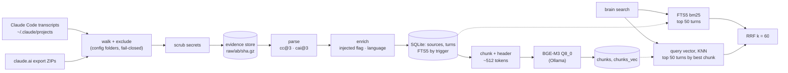

# How the brain works

A living description of the algorithm, updated by every work package that changes it. `SPEC.md` says what the brain should do; this file says what the code does today. Last updated by WP7 (#7).

## Pipeline

`brain ingest <path...>` runs the chain up to the turns; `brain index` embeds what is new or changed; `brain search <query>` reads both indexes. Every step can be re-run: same input, same database.

## 1. Evidence store and scrubbing (WP2, WP3)

- **Scrub before storing.** Every file is scrubbed before it touches disk (`src/scrub.ts`, version `scrub@1`). Rules find keys and tokens by shape (Anthropic, OpenAI, GitHub, AWS, Slack, Stripe, Google, JWT, PEM private keys), credentials in URLs, auth headers, passwords on command lines, and secrets assigned to names like `password` or `api_key` in `.env` and code. A match becomes `[REDACTED:<kind>]`. JSON is scrubbed in place on its raw text, so the file stays valid JSON. A JSONL line cut off mid-write is replaced by a marker line.
- **Content-addressed.** The scrubbed copy is gzipped to `raw/<ab>/<sha256>.gz`, keyed by the SHA-256 of the *original* bytes (`raw_files` table). Storing the same bytes twice does nothing. A missing or damaged copy is rewritten.
- **Owner-only.** The database is chmod 600 and its folder 700.
- **Exclusion.** Claude Code project folders matching `claudeCode.exclude` in the config are never stored or parsed. The check fails closed: any folder of the path that matches excludes the file, and that includes an export ZIP found inside one.

## 2. Parsing (WP4, WP5)

Parsers are pure functions: stored text in, one `sources` row and its `turns` out. Unknown line types and blocks are counted and skipped, never fatal, because the raw copy stays in the store.

**Claude Code (`src/parsers/claudeCode.ts`).** One source per session, subagent transcript or auto-memory file. `user` and `assistant` lines become turns. A user line holding only tool results gets the role `tool`. Thinking is left out. A turn's parent is its nearest *stored* ancestor, found by walking past attachments, system lines and compaction boundaries (`logicalParentUuid`). Any path is first mapped to the `/projects/<dir>/…` shape (`projectsView`), so exclusion and parsing do not depend on where the folder sits.

**claude.ai export (`src/parsers/claudeAi.ts`, `src/claudeAiExport.ts`).**
- Kinds:
  - `cai`: conversations
  - `cap`: projects
  - `mem`: memory
  - `cad`: design chats
  - `caa`: artifacts
- Account metadata and `claude_code_cloud` are never stored.
- Conversations keep every branch. Empty messages are dropped, and their children hang on the nearest stored ancestor.
- An export is recognised by the structure of its entries, not their file names. Unreadable JSON is reported, never stored.
- HTML artifacts are stored as text, without script, style or markup.
- The memory set is dated by its ZIP entry time, else by the ZIP file's modification time.
- One transaction per export.

**Update rules.**
- A source is re-parsed when its raw copy or the parser version changed.
- An older copy never overwrites a newer one:
  - a Claude Code transcript only grows, so fewer turns or an earlier last turn means older;
  - a claude.ai source is older when its `updated_at` is earlier;
  - for memory files, the copy received last wins.

## 3. Writing turns (`writeSource`, `src/sources.ts`)

Shared by every parser, in one transaction per source:
1. Scrub the title, project hint and each turn's text once more. Parsers join and decode text, which can put back together a secret that no single piece contained.
2. Detect each turn's language (section 4).
3. Upsert the source, then upsert each turn by `(source, external_uuid)`. A turn is written only if something changed, so unchanged turns keep their id, FTS row and vectors.
4. Delete turns the new parse no longer has.

FTS5 (`unicode61 remove_diacritics 2`) is kept in sync by triggers. A deleted turn takes its FTS row, chunks and vectors with it.

## 4. Enrichment (WP6, `src/enrich.ts`)

### Injected content (`is_injected`)

Text the harness added, as opposed to text a person or Claude wrote, is kept and searchable, and flagged `is_injected = 1` so that Phase 1 never extracts claims from it.

| Where | Rule |
| --- | --- |
| Claude Code `attachment` line of type `hook_additional_context` | Stored as its own turn (role `user`), flagged, in the thread between the prompt and the reply. Other attachment types (environment, tool lists, file snapshots, `hook_success` stdout, which duplicates the context) stay skipped. |
| Claude Code user line with `isMeta` or `isCompactSummary` | The whole turn is flagged: skill bodies, image notes, messages relayed from other agents, compaction summaries. |
| Tagged spans in a user or tool turn: `<system-reminder>`, `<task-notification>`, `<local-command-caveat>`, `<local-command-stdout>`, `<local-command-stderr>`, `<user-prompt-submit-hook>`, `<ide_opened_file>`, `<ide_selection>` | Split out. The person's words stay in the turn, unflagged. The spans go to a child turn `<uuid>#injected`, flagged. A turn that is nothing but spans is flagged whole. A tag left open is not a span. Spans are found with indexOf, so the cost stays linear even with thousands of unclosed tags. |
| claude.ai `injected_prompt_block` (memory snapshots, date notes, reminders), and the same tagged spans in human text | Same split: a child turn `<uuid>#injected`. A message that is only injected context is stored whole, flagged. |

Assistant text is never split: when Claude writes `<system-reminder>`, it is talking about the tag.

### Language (`lang`: `fr`, `en`, `mixed`, or null)

- The detector reads only the first 64 KB of a turn, with linear steps only (a multi-megabyte tool result cannot stall ingest).
- Before counting, it ignores fenced and inline code, URLs, paths, `[tool_use …]` lines, `<pasted_content>` blocks and attached files.
- The rest is split into sentences. Each sentence counts French and English function words from two lists that share no word (`le`, `est`, `pour`… against `the`, `is`, `with`…). Words like `a`, `on` or `me`, which exist in both languages, are in neither list.
- Each sentence goes to the language it has more words of.
- Fewer than 2 function words in the whole turn gives null (too short or too technical to call).
- A turn is `mixed` when the smaller language holds at least 20% of the counted words, and at least 4 of them.

### Versions

`ENRICH_VERSION` (`enrich@1`) is part of both parser versions (`cc@3+enrich@1`, `cai@3+enrich@1`). Changing a rule means bumping it, so the next ingest re-parses everything and no turn keeps a flag or language from the old rules.

### Measured on the real data (2026-10-24)

- 10,058 turns.
- 341 flagged as injected: 266 Claude Code user turns, 6 tool turns, 69 claude.ai turns.
- Language:

  | `lang` | Turns |
  | --- | --- |
  | `en` | 4,967 |
  | `fr` | 891 |
  | `mixed` | 297 |
  | null | 3,903 (mostly tool output) |

- Hand check of 50 sampled turns (20 flagged, 30 unflagged user and tool turns): no wrong flag.
- The second ingest writes 0 turns, and no turn points to a missing parent.

## 5. Meaning index (WP7, `src/chunk.ts`, `src/vectors.ts`, `src/embed.ts`)

### What is embedded

| Turn | Embedded |
| --- | --- |
| user, assistant, doc, memory, comment | every chunk |
| tool output (about a quarter of all text: file contents, logs) | the first chunk only |
| `is_injected` | nothing: keyword search only |
| empty, or in an excluded source | nothing |

Before chunking, each `[tool_use <name>] <json>` line in a turn is cut to its first 300 characters: past the name and the first arguments, a written file or a diff says what was written, not what was meant. Keyword search still has the full line.

### Chunks

- **Size:** at most 1,400 characters, about 512 BGE-M3 tokens (the stored turns average 2.75 characters per token). Most turns are a single chunk.
- **Cut:** at the last paragraph break in the second half of the window, else the last line break, sentence end or space, else at the limit (never inside a surrogate pair). Each search stays inside the window, so chunking is linear: 2 MB without a single break takes about 60 ms.
- **Overlap:** the next chunk starts about 180 characters (64 tokens) before the cut, at a word start.
- **Context header:** before each chunk, the source title and `> ` plus the first line of the turn it answers, each cut to 150 characters. The turn it answers is the nearest ancestor a person or Claude wrote: tool output and injected turns are passed over. "yes, do that" is found by the question before it.
- **Not stored.** A chunk's text is cut again from its turn when needed. `chunks` holds `turn_id`, `ord` and `input_sha256`, the hash of the exact text embedded, header included.

### Vectors

- **Model:** BGE-M3 quantised to Q8_0 (`hf.co/gpustack/bge-m3-GGUF:Q8_0`, 634 MB), through Ollama. On sample turns its vectors have cosine 0.9993 to 0.9995 against F16. The laptop and the server must run this same file. Set by `embedding.model` and `embedding.url` in the config.
- **No silent truncation.** Ollama cuts every input to 2,048 tokens unless `num_ctx` and `num_batch` are raised, and says nothing. Requests set both to 8,192 and pass `truncate: false`, so a too-long input is an error (HTTP 413), never a cut vector.
- **Storage:** `chunks_vec` (sqlite-vec `vec0`, 1024 dims, cosine distance), with `model` and `dims` on every row. Deleting a chunk deletes its vector by trigger; deleting a turn deletes its chunks by foreign key.
- **Incremental.** `brain index` hashes every turn's inputs and embeds only the turns whose hashes changed or whose vectors come from another model. A changed title therefore re-embeds the turns of its source. Turns that no longer have chunks (now injected, or emptied) lose them. Each turn is written in its own transaction once all its chunks are embedded, so an interrupted run keeps every turn it finished.
- **Rebuild:** `brain index --rebuild` deletes every chunk and vector, then embeds everything again. Chunking is deterministic, so the inputs, and the results, are the same.

## 6. Search (WP7, `src/search.ts`)

1. **Keyword:** every word of the query, quoted, joined by OR, matched in `turns_fts` and ranked by bm25. The top 50 turns.
2. **Meaning:** the query is embedded as it is (BGE-M3 takes no query prefix). The 200 nearest chunks with the current model's vectors are grouped by turn, and a turn takes the rank of its best chunk. The top 50 turns.
3. **Fusion:** reciprocal rank fusion, `score = Σ 1 / (60 + rank)` over both lists. Ties go to the better keyword rank, then to the older turn, so the same query always gives the same order.
4. **Filters:** turns of excluded sources never appear. Injected turns are left out unless `--injected` is given.
5. **Snippet:** the FTS5 snippet when the turn matched by keyword, else the start of its best chunk.

When Ollama cannot be reached, search returns the keyword results and says so. It also warns when turns are not yet in the meaning index, or when chunks were embedded with another model, which search ignores.

## Known gaps

- Pruning superseded transcript copies, and clean-up of `.tmp` files (#20).
- A per-session `#nobrain` opt-out (#22).
- Files nested inside artifact bundles are not ingested (15 entries in the current export).
- `queued_command` attachments (a prompt typed while Claude was busy) are skipped. Most of them also appear later as a user line, but not all of them.
- Code pasted without fences can come out as `mixed`.
- The keyword query is an OR of every word, function words included. bm25 weighs common words down, but a query made only of them matches almost everything.
- Chunk size, the context header and tool-output handling are first guesses, to be tuned on the evaluation set (#9, #10).

## Changelog

| Work package | PR | What changed in the algorithm |
| --- | --- | --- |
| WP1 skeleton | #16 | Schema v1 (`sources`, `turns`, FTS5 triggers, `turns_vec`), `brain init`. |
| WP3 scrubber | #17 | `scrub@1` rules, JSON scrubbed in place, `brain scrub --dry-run`. |
| WP2 evidence store | #18 | Content-addressed scrubbed gzip store, `raw_files`, `brain ingest`. |
| WP4 Claude Code parser | #21 | `cc@2`: turns, nearest stored parent, fail-closed exclusion, older-copy rule. |
| WP5 claude.ai export | #23 | `cai@2`: five kinds, all branches, structure-based recognition, HTML as text, final scrub in `writeSource`. |
| WP6 turn enrichment | #24 | `enrich@1`: injected flags and split-off `#injected` turns, hook context stored, per-turn language. |
| WP7 hybrid index | this PR | Schema v4 (`chunks`, `chunks_vec`; `turns_vec` dropped). Chunks with context headers, BGE-M3 Q8_0 via Ollama, incremental `brain index`, `brain search` with RRF k = 60. |
