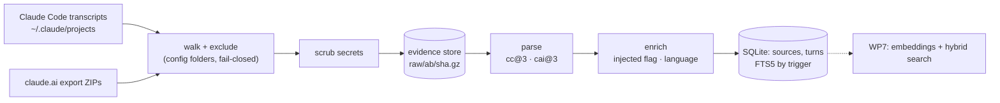

# How the brain works

A living description of the algorithm, updated by every work package that changes it. `SPEC.md` says what the brain should do; this file says what the code does today. Last updated by WP6 (#6).

## Pipeline

`brain ingest <path...>` runs the whole chain. Every step can be re-run: same input, same database.

## 1. Evidence store and scrubbing (WP2, WP3)

- **Scrub before storing.** Every file is scrubbed before it touches disk (`src/scrub.ts`, version `scrub@1`). Rules find keys and tokens by shape (Anthropic, OpenAI, GitHub, AWS, Slack, Stripe, Google, JWT, PEM private keys), credentials in URLs, auth headers, passwords on command lines, and secrets assigned to names like `password` or `api_key` in `.env` and code. A match becomes `[REDACTED:<kind>]`. JSON is scrubbed in place on its raw text, so the file stays valid JSON. A JSONL line cut off mid-write is replaced by a marker line.
- **Content-addressed.** The scrubbed copy is gzipped to `raw/<ab>/<sha256>.gz`, keyed by the SHA-256 of the *original* bytes (`raw_files` table). Storing the same bytes twice does nothing. A missing or damaged copy is rewritten.
- **Owner-only.** The database is chmod 600 and its folder 700.
- **Exclusion.** Claude Code project folders matching `claudeCode.exclude` in the config are never stored or parsed. The check fails closed: any folder of the path that matches excludes the file, and that includes an export ZIP found inside one.

## 2. Parsing (WP4, WP5)

Parsers are pure functions: stored text in, one `sources` row and its `turns` out. Unknown line types and blocks are counted and skipped, never fatal, because the raw copy stays in the store.

**Claude Code (`src/parsers/claudeCode.ts`).** One source per session, subagent transcript or auto-memory file. `user` and `assistant` lines become turns. A user line holding only tool results gets the role `tool`. Thinking is left out. A turn's parent is its nearest *stored* ancestor, found by walking past attachments, system lines and compaction boundaries (`logicalParentUuid`). Any path is first mapped to the `/projects/<dir>/…` shape (`projectsView`), so exclusion and parsing do not depend on where the folder sits.

**claude.ai export (`src/parsers/claudeAi.ts`, `src/claudeAiExport.ts`).**
- Kinds:
  - `cai`: conversations
  - `cap`: projects
  - `mem`: memory
  - `cad`: design chats
  - `caa`: artifacts
- Account metadata and `claude_code_cloud` are never stored.
- Conversations keep every branch. Empty messages are dropped, and their children hang on the nearest stored ancestor.
- An export is recognised by the structure of its entries, not their file names. Unreadable JSON is reported, never stored.
- HTML artifacts are stored as text, without script, style or markup.
- The memory set is dated by its ZIP entry time, else by the ZIP file's modification time.
- One transaction per export.

**Update rules.**
- A source is re-parsed when its raw copy or the parser version changed.
- An older copy never overwrites a newer one:
  - a Claude Code transcript only grows, so fewer turns or an earlier last turn means older;
  - a claude.ai source is older when its `updated_at` is earlier;
  - for memory files, the copy received last wins.

## 3. Writing turns (`writeSource`, `src/sources.ts`)

Shared by every parser, in one transaction per source:
1. Scrub the title, project hint and each turn's text once more. Parsers join and decode text, which can put back together a secret that no single piece contained.
2. Detect each turn's language (section 4).
3. Upsert the source, then upsert each turn by `(source, external_uuid)`. A turn is written only if something changed, so unchanged turns keep their id, FTS row and (later) vector.
4. Delete turns the new parse no longer has.

FTS5 (`unicode61 remove_diacritics 2`) is kept in sync by triggers. A deleted turn takes its FTS row and vector with it.

## 4. Enrichment (WP6, `src/enrich.ts`)

### Injected content (`is_injected`)

Text the harness added, as opposed to text a person or Claude wrote, is kept and searchable, and flagged `is_injected = 1` so that Phase 1 never extracts claims from it.

| Where | Rule |
| --- | --- |
| Claude Code `attachment` line of type `hook_additional_context` | Stored as its own turn (role `user`), flagged, in the thread between the prompt and the reply. Other attachment types (environment, tool lists, file snapshots, `hook_success` stdout, which duplicates the context) stay skipped. |
| Claude Code user line with `isMeta` or `isCompactSummary` | The whole turn is flagged: skill bodies, image notes, messages relayed from other agents, compaction summaries. |
| Tagged spans in a user or tool turn: `<system-reminder>`, `<task-notification>`, `<local-command-caveat>`, `<local-command-stdout>`, `<local-command-stderr>`, `<user-prompt-submit-hook>` | Split out. The person's words stay in the turn, unflagged. The spans go to a child turn `<uuid>#injected`, flagged. A turn that is nothing but spans is flagged whole. A tag left open is not a span. |
| claude.ai `injected_prompt_block` (memory snapshots, date notes, reminders), and the same tagged spans in human text | Same split: a child turn `<uuid>#injected`. A message that is only injected context is stored whole, flagged. |

Assistant text is never split: when Claude writes `<system-reminder>`, it is talking about the tag.

### Language (`lang`: `fr`, `en`, `mixed`, or null)

- Before counting, the detector ignores fenced and inline code, URLs, paths, `[tool_use …]` lines, `<pasted_content>` blocks and attached files.
- The rest is split into sentences. Each sentence counts French and English function words from two lists that share no word (`le`, `est`, `pour`… against `the`, `is`, `with`…). Words like `a`, `on` or `me`, which exist in both languages, are in neither list.
- Each sentence goes to the language it has more words of.
- Fewer than 2 function words in the whole turn gives null (too short or too technical to call).
- A turn is `mixed` when the smaller language holds at least 20% of the counted words, and at least 4 of them.

### Versions

`ENRICH_VERSION` (`enrich@1`) is part of both parser versions (`cc@3+enrich@1`, `cai@3+enrich@1`). Changing a rule means bumping it, so the next ingest re-parses everything and no turn keeps a flag or language from the old rules.

### Measured on the real data (2026-10-24)

- 9,986 turns.
- 338 flagged as injected: 264 Claude Code user turns, 5 tool turns, 69 claude.ai turns.
- Language:

  | `lang` | Turns |
  | --- | --- |
  | `en` | 4,943 |
  | `fr` | 882 |
  | `mixed` | 299 |
  | null | 3,862 (mostly tool output) |

- Hand check of 50 sampled turns (20 flagged, 30 unflagged user and tool turns): no wrong flag.
- The second ingest writes 0 turns, and no turn points to a missing parent.

## 5. Search (WP7, next)

Planned per `SPEC.md` and #7: FTS5 ranking plus BGE-M3 embeddings (1024 dims, in `turns_vec`, with the model and dims stored per row), fused by reciprocal rank fusion with k = 60. Injected turns will be searchable but kept out of default results. The choice of where embeddings run comes from #15.

## Known gaps

- Pruning superseded transcript copies, and clean-up of `.tmp` files (#20).
- A per-session `#nobrain` opt-out (#22).
- Files nested inside artifact bundles are not ingested (15 entries in the current export).
- `queued_command` attachments (a prompt typed while Claude was busy) are skipped. Most of them also appear later as a user line, but not all of them.
- Code pasted without fences can come out as `mixed`.

## Changelog

| Work package | PR | What changed in the algorithm |
| --- | --- | --- |
| WP1 skeleton | #16 | Schema v1 (`sources`, `turns`, FTS5 triggers, `turns_vec`), `brain init`. |
| WP3 scrubber | #17 | `scrub@1` rules, JSON scrubbed in place, `brain scrub --dry-run`. |
| WP2 evidence store | #18 | Content-addressed scrubbed gzip store, `raw_files`, `brain ingest`. |
| WP4 Claude Code parser | #21 | `cc@2`: turns, nearest stored parent, fail-closed exclusion, older-copy rule. |
| WP5 claude.ai export | #23 | `cai@2`: five kinds, all branches, structure-based recognition, HTML as text, final scrub in `writeSource`. |
| WP6 turn enrichment | this PR | `enrich@1`: injected flags and split-off `#injected` turns, hook context stored, per-turn language. |
