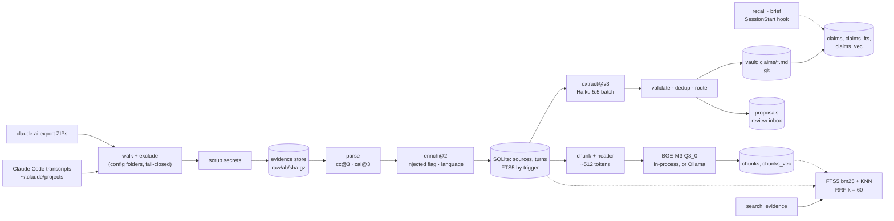

# How glia works

A living description of the algorithm, updated by every work package that changes it. `SPEC.md` says what glia should do; this file says what the code does today. Last updated at 0.1.2 (Phase 0, Phase 1 and Packaging).

## Pipeline

`glia ingest <path...>` runs the chain up to the turns; `glia index` embeds what is new or changed; `glia search <query>` reads both indexes. `glia extract` submits the claim extraction and `glia extract poll` turns its results into claims and proposals; `glia review` works through the proposals. `glia daemon` runs all of it on a clock (section 11). Every step can be re-run: same input, same database.

## 1. Evidence store and scrubbing (WP2, WP3)

- **Scrub before storing.** Every file is scrubbed before it touches disk (`src/scrub.ts`, version `scrub@1`). Rules find keys and tokens by shape (Anthropic, OpenAI, GitHub, AWS, Slack, Stripe, Google, JWT, PEM private keys), credentials in URLs, auth headers, passwords on command lines, and secrets assigned to names like `password` or `api_key` in `.env` and code. A match becomes `[REDACTED:<kind>]`. JSON is scrubbed in place on its raw text, so the file stays valid JSON. A JSONL line cut off mid-write is replaced by a marker line.
- **Paths too.** The path a file was read from is scrubbed segment by segment, split on `/` and `\` alike, so a secret in a file name (`DB_PASSWORD=….md`) is redacted on every platform.
- **Content-addressed.** The scrubbed copy is gzipped to `raw/<ab>/<sha256>.gz`, keyed by the SHA-256 of the *original* bytes (`raw_files` table). Storing the same bytes twice does nothing. A missing or damaged copy is rewritten.
- **Every origin.** `raw_file_origins` records each path a raw file was read from, not only the first one.
- **Superseded copies are pruned (#20, `src/prune.ts`).** A growing transcript is stored again in full each time it changes. After each ingest, an older copy of a Claude Code transcript is pruned when every complete line of it opens the copy its source was parsed from. A last line cut off mid-write is left out of that check. The file is deleted and the row kept with `pruned_at`, so the same bytes met again are neither stored nor parsed. The copy a source points to is never pruned. A rewritten copy, or one scrubbed under other rules, is kept and counted. Memory files keep every version. Transcripts read from Windows paths are matched the same way. `.tmp` files older than an hour, left by a killed ingest, are removed at the start of ingest.
- **Owner-only.** The database is chmod 600 and its folder 700 (no effect on Windows, which has no POSIX modes).
- **Exclusion.** Claude Code project folders matching `claudeCode.exclude` in the config are never stored or parsed. The check fails closed: any folder of the path that matches excludes the file, and that includes an export ZIP found inside one.
- **Excluded after the fact.** A project excluded once its sessions were stored is applied on every ingest, and at once by `glia init --exclude`: a Claude Code source whose copy was read from any path in an excluded project is marked `sources.excluded = 1`, and back to 0 when the pattern goes. Search, the meaning index, MCP and extraction all leave excluded sources out. Their rows and raw copies stay, so the change can be undone.

### Session opt-out (#22, `src/optOut.ts`)

- **Marker:** `#nobrain` (any case) on a line of its own, in a message the user typed, sent or queued while Claude was busy (`queued_command` attachments from a human). Tool output, Claude's text, injected context, compaction summaries and subagent prompts do not count. Neither does the marker inside a sentence, so talking about it ("#nobrain is fine") opts nothing out.
- **Scope:** the session transcript and everything in its `<id>/` folder (subagent transcripts, saved tool output, an export ZIP put there). A file in the folder is decided by reading the transcript next to it, because the walk reaches the folder first. The session is read from the file's place under `projects/`, else from its path on disk, so a session folder copied elsewhere is recognised as long as its transcript sits next to it. Paths with either separator are read.
- **Before storing:** an opted-out session's files are never scrubbed into the store.
- **Purge, once:** the first ingest that sees the marker deletes the session's sources (turns, chunks and vectors go with them) and every raw copy whose origin is the transcript or its folder, with `/` or `\` separators. A raw file still backing another source is kept. Files are deleted before rows: a failed delete stops the purge before any row changes, and a crash in between is purged again by the next ingest.
- **Audit:** `opt_outs` (schema v5) records the session id, the time and the purge counts, never content. Later ingests skip the session without reading it again.

## 2. Parsing (WP4, WP5)

Parsers are pure functions: stored text in, one `sources` row and its `turns` out. Unknown line types and blocks are counted and skipped, never fatal, because the raw copy stays in the store.

**Claude Code (`src/parsers/claudeCode.ts`).** One source per session, subagent transcript or auto-memory file. `user` and `assistant` lines become turns. A user line holding only tool results gets the role `tool`. Thinking is left out. A turn's parent is its nearest *stored* ancestor, found by walking past attachments, system lines and compaction boundaries (`logicalParentUuid`). Any path is first mapped to the `/projects/<dir>/…` shape (`projectsView`, which reads Windows paths too), so exclusion and parsing do not depend on where the folder sits.

**claude.ai export (`src/parsers/claudeAi.ts`, `src/claudeAiExport.ts`).**
- Kinds:
  - `cai`: conversations
  - `cap`: projects
  - `mem`: memory
  - `cad`: design chats
  - `caa`: artifacts
- Account metadata and `claude_code_cloud` are never stored.
- Conversations keep every branch. Empty messages are dropped, and their children hang on the nearest stored ancestor.
- An export is recognised by the structure of its entries, not their file names. Unreadable JSON is reported, never stored.
- HTML artifacts are stored as text, without script, style or markup.
- The memory set is dated by its ZIP entry time, else by the ZIP file's modification time.
- One transaction per export.

**Update rules.**
- A source is re-parsed when its raw copy or the parser version changed.
- An older copy never overwrites a newer one:
  - a Claude Code transcript only grows, so fewer turns or an earlier last turn means older;
  - a claude.ai source is older when its `updated_at` is earlier;
  - for memory files, the copy received last wins.

## 3. Writing turns (`writeSource`, `src/sources.ts`)

Shared by every parser, in one transaction per source:
1. Scrub the title, project hint and each turn's text once more. Parsers join and decode text, which can put back together a secret that no single piece contained.
2. Detect each turn's language (section 4).
3. Upsert the source, then upsert each turn by `(source, external_uuid)`. A turn is written only if something changed, so unchanged turns keep their id, FTS row and vectors.
4. Delete turns the new parse no longer has.

FTS5 (`unicode61 remove_diacritics 2`) is kept in sync by triggers. A deleted turn takes its FTS row, chunks and vectors with it.

## 4. Enrichment (WP6, WP18, `src/enrich.ts`)

### Injected content (`is_injected`)

Text the harness added, as opposed to text a person or Claude wrote, is kept and searchable, and flagged `is_injected = 1` so that extraction never reads it.

| Where | Rule |
| --- | --- |
| Claude Code `attachment` line of type `hook_additional_context` | Stored as its own turn (role `user`), flagged, in the thread between the prompt and the reply. Other attachment types (environment, tool lists, file snapshots, `hook_success` stdout, which duplicates the context) stay skipped. |
| Claude Code user line with `isMeta` or `isCompactSummary` | The whole turn is flagged: skill bodies, image notes, messages relayed from other agents, compaction summaries. |
| Tagged spans in a user or tool turn: `<system-reminder>`, `<task-notification>`, `<local-command-caveat>`, `<local-command-stdout>`, `<local-command-stderr>`, `<user-prompt-submit-hook>`, `<ide_opened_file>`, `<ide_selection>`, and glia's own `<glia-claims>` (`<brain-claims>` before the rename) | Split out. The person's words stay in the turn, unflagged. The spans go to a child turn `<uuid>#injected`, flagged. A turn that is nothing but spans is flagged whole. A tag left open is not a span. Spans are found with indexOf, so the cost stays linear even with thousands of unclosed tags. |
| claude.ai `injected_prompt_block` (memory snapshots, date notes, reminders), and the same tagged spans in human text | Same split: a child turn `<uuid>#injected`. A message that is only injected context is stored whole, flagged. |

Assistant text is never split: when Claude writes `<system-reminder>`, it is talking about the tag.

### Language (`lang`: `fr`, `en`, `mixed`, or null)

- The detector reads only the first 64 KB of a turn, with linear steps only (a multi-megabyte tool result cannot stall ingest).
- Before counting, it ignores fenced and inline code, URLs, paths, `[tool_use …]` lines, `<pasted_content>` blocks and attached files.
- The rest is split into sentences. Each sentence counts French and English function words from two lists that share no word (`le`, `est`, `pour`… against `the`, `is`, `with`…). Words like `a`, `on` or `me`, which exist in both languages, are in neither list.
- Each sentence goes to the language it has more words of.
- Fewer than 2 function words in the whole turn gives null (too short or too technical to call).
- A turn is `mixed` when the smaller language holds at least 20% of the counted words, and at least 4 of them.

### Versions

`ENRICH_VERSION` (`enrich@2`, which added the claims tags) is part of both parser versions (`cc@3+enrich@2`, `cai@3+enrich@2`). Changing a rule means bumping it, so the next ingest re-parses everything and no turn keeps a flag or language from the old rules.

### Measured on the real data (2026-10-24, enrich@1)

- 10,058 turns.
- 341 flagged as injected: 266 Claude Code user turns, 6 tool turns, 69 claude.ai turns.
- Language:

  | `lang` | Turns |
  | --- | --- |
  | `en` | 4,967 |
  | `fr` | 891 |
  | `mixed` | 297 |
  | null | 3,903 (mostly tool output) |

- Hand check of 50 sampled turns (20 flagged, 30 unflagged user and tool turns): no wrong flag.
- The second ingest writes 0 turns, and no turn points to a missing parent.

## 5. Meaning index (WP7, Packaging, `src/chunk.ts`, `src/vectors.ts`, `src/embed.ts`, `src/embedLlama.ts`)

### What is embedded

| Turn | Embedded |
| --- | --- |
| user, assistant, doc, memory, comment | every chunk |
| tool output (about a quarter of all text: file contents, logs) | the first chunk only |
| `is_injected` | nothing: keyword search only |
| empty, or in an excluded source | nothing |

Before chunking, each `[tool_use <name>] <json>` line in a turn is cut to its first 300 characters: past the name and the first arguments, a written file or a diff says what was written, not what was meant. Keyword search still has the full line.

### Chunks

- **Size:** at most 1,400 characters, about 512 BGE-M3 tokens (the stored turns average 2.75 characters per token). Most turns are a single chunk.
- **Cut:** at the last paragraph break in the second half of the window, else the last line break, sentence end or space, else at the limit (never inside a surrogate pair). Each search stays inside the window, so chunking is linear: 2 MB without a single break takes about 60 ms.
- **Overlap:** the next chunk starts about 180 characters (64 tokens) before the cut, at a word start.
- **Context header:** before each chunk, the source title and `> ` plus the first line of the turn it answers, each cut to 150 characters. The turn it answers is the nearest ancestor a person or Claude wrote: tool output and injected turns are passed over. "yes, do that" is found by the question before it.
- **Not stored.** A chunk's text is cut again from its turn when needed. `chunks` holds `turn_id`, `ord` and `input_sha256`, the hash of the exact text embedded, header included.

### Vectors

- **Model:** BGE-M3 quantised to Q8_0 (`hf.co/gpustack/bge-m3-GGUF:Q8_0`, 634 MB). On sample turns its vectors have cosine 0.9993 to 0.9995 against F16. Every machine that shares a database must run this same file.
- **Where it runs.** By default inside glia's own process (node-llama-cpp), from `<data folder>/models/bge-m3-Q8_0.gguf`, which `glia init` downloads once. Measured against Ollama on 200 real chunks: minimum cosine 0.99975, the same speed. It runs with a batch size of 8,192 (the default 512 makes chunks longer than 512 tokens drift), with BOS and EOS tokens around the text, and on the CPU (automatic GPU selection lost the device on an AMD GPU). Ollama is used instead when `embedding.provider` is `ollama`, when `embedding.model` names another model, or when node-llama-cpp cannot load or the model file is missing.
- **No silent truncation (Ollama).** Ollama cuts every input to 2,048 tokens unless `num_ctx` and `num_batch` are raised, and says nothing. Requests set both to 8,192 and pass `truncate: false`, so a too-long input is an error (HTTP 413), never a cut vector.
- **Storage:** `chunks_vec` (sqlite-vec `vec0`, 1024 dims, cosine distance), with `model` and `dims` on every row. Deleting a chunk deletes its vector by trigger; deleting a turn deletes its chunks by foreign key.
- **Incremental.** `glia index` hashes every turn's inputs and embeds only the turns whose hashes changed or whose vectors come from another model. A changed title therefore re-embeds the turns of its source. Turns that no longer have chunks (now injected, or emptied) lose them. Each turn is written in its own transaction once all its chunks are embedded, so an interrupted run keeps every turn it finished.
- **Rebuild:** `glia index --rebuild` deletes every chunk and vector, then embeds everything again. Chunking is deterministic, so the inputs, and the results, are the same.

## 6. Search (WP7, `src/search.ts`)

1. **Keyword:** every word of the query, quoted, joined by OR, matched in `turns_fts` and ranked by bm25. The top 50 turns.
2. **Meaning:** the query is embedded as it is (BGE-M3 takes no query prefix). The 200 nearest chunks with the current model's vectors are grouped by turn, and a turn takes the rank of its best chunk. The top 50 turns.
3. **Fusion:** reciprocal rank fusion, `score = Σ 1 / (60 + rank)` over both lists. Ties go to the better keyword rank, then to the older turn, so the same query always gives the same order.
4. **Filters:** turns of excluded sources never appear. Injected turns are left out unless `--injected` is given.
5. **Snippet:** the FTS5 snippet when the turn matched by keyword, else the start of its best chunk.

When the embedder cannot be reached, search returns the keyword results and says so. It also warns when turns are not yet in the meaning index, or when chunks were embedded with another model, which search ignores.

## 7. Serving over MCP (WP8, WP18, `src/mcp.ts`)

`glia mcp` serves four read-only tools over stdio, and reports the package version as its server version. The embedder is loaded on the first query that needs it, not at start.

- **`search_evidence`** runs the search in section 6. The `source_kind`, `from` and `to` filters go into both indexes' SQL, so they shape the candidate lists instead of thinning the fused result. `from` compares `ts >= from`. `to` compares the first characters of `ts`, as many as `to` has, so a bare date covers its whole day. Turns without a `ts` drop out once either bound is set. With any filter set, the meaning side reads its 1,000 nearest chunks instead of 200, because the nearest ones may all be filtered out.
- **`open_evidence`** walks the conversation tree, not the clock. Before the cited turn: the parent chain. After it: the earliest child at each step, so a regenerated answer does not break into the main line. Injected turns are walked through but not shown. Excluded sources are not found.
- **Size:** the cited turn is cut at 24,000 characters and each neighbour at 2,000. The result is capped at 50,000 characters (about 18k tokens at 2.75 characters per token). When the cap is reached, the neighbours nearest the cited turn are kept, alternating after and before.
- **`recall`** and **`brief`** serve claims (section 10).

## 8. Claims: extraction (WP11 to WP16, `src/extract*.ts`, `src/validate.ts`, `src/dedup.ts`, `src/route.ts`)

Extraction only ever proposes: nothing in it edits or deletes a claim that exists, except to add evidence to it. It needs an Anthropic API key in `~/.config/glia/env` (never the shell's `ANTHROPIC_API_KEY`, which a Claude Code session sets for itself), and always calls `api.anthropic.com` directly, whatever `ANTHROPIC_BASE_URL` says.

### Input (`src/extractInput.ts`)

- **Sources:** kinds `cc`, `cai`, `cad`, `cap` and `mem`, not excluded. Artifacts (`caa`) are Claude's own output and are never sent.
- **Turns:** not injected, not sidechain, not tool output. What the model sees of a turn is its own text with injected spans removed and each `[tool_use …]` line cut to 300 characters, with every claim statement ever served to a client (`retrievals`) removed from it, scrubbed once more. A turn left empty is dropped. Turns are numbered `T1`, `T2`… over the whole source.
- **Only what changed:** the input hash of a source (turn ids and texts) is kept in `extraction_state` (schema v9) when it is submitted; a source is sent again only when that hash changes, or when its request failed. `--from <date>` limits the run to sources updated since then.
- **Scope hint:** each source carries the project it belongs to, so the model does not guess a slug. It is the project in `config.projects` that lists the session's folder (or a parent) or its git remote, else the repository name of the folder's `origin` remote, else the folder name, as a lowercase slug (`project:<slug>`). The SessionStart hook resolves a folder the same way, so a project's claims carry the scope its sessions are briefed on. claude.ai sources have no folder and no hint.

### Requests and the batch (`src/extractor.ts`, `src/extractPrompt.ts`)

- **Cut:** a source is cut on turn boundaries into requests of at most 180,000 characters (about 80k tokens at the 2.25 characters per token measured on these sources); a turn longer than that alone is cut at whitespace. Each request is then counted with the API's token counter; one over 97,000 tokens (under Haiku's 100k price step, with room for the prompt) is cut again at half its size, down to 10,000 characters.
- **Model:** `claude-haiku-5-5` through the Batch API, structured output against the extraction schema (`extract@v3`), up to 16,000 output tokens, effort medium. The prompt asks for durable facts about the user only, never personality judgements, statements in the language of the quoted turns, quotes copied exactly (5 to 40 words), origins by who said it, and relative time resolved against the turn's timestamp.
- **One batch at a time.** `glia extract` refuses while a batch is still running. The job row (`jobs`, schema v10) maps each request to its source and its turn refs, so a poll that dies part way resumes without resubmitting.
- **Poll:** once the batch has ended, every request that succeeded, stopped at `end_turn` and parses against the schema becomes `candidates` rows (state `new`). A request that errored, expired or did not parse makes its source forgotten in `extraction_state`, so the next submit sends it again. The job is closed only after every result is read.

### Validation (`src/validate.ts`)

Each new candidate is kept (`valid`) or dropped with its reason:

| Check | Dropped as |
| --- | --- |
| a blank statement | `empty_statement` |
| no evidence | `no_evidence` |
| a personality or psychological judgement (`anxious`, `perfectionist`, `is the kind of person`, `manque de confiance`…; "tends to" is allowed, it is a habit) | `personality` |
| a scope that is not `global`, `project:<slug>` or `context:<tag>` | `bad_scope` |
| a cited turn the request did not hold | `unknown_turn` |
| a quote that is not in the cited turn's text as sent, word for word (only whitespace may differ, and is fixed) | `quote_not_verbatim` |

Then the candidate is corrected:
- **Origin is only ever lowered,** never raised to one that can be auto-accepted. A claim said to be the user's whose cited turns are all memory becomes `imported_memory`; one that quotes only pasted text, attachments or a claude.ai project document becomes `external_doc`; one with no user turn among its quotes becomes `ai_suggested`. `user_confirmed` needs a user turn after a cited assistant turn, else it is `user_stated`.
- **Valid time** is resolved from the time words against the first cited turn's timestamp: "last year", "le mois dernier", "yesterday", "la semaine dernière" (approx), a month name (the latest one not after the turn), a year. Future words ("next", "bientôt") set nothing. Without time words, the model's date is kept only if it is a date not later than the turn, with the precision its length gives.
- Evidence takes its vault form: `source` (`<kind>:<external id>`), `turn` (the message uuid), `quote` and `quote_sha256`.

### Deduplication (`src/dedup.ts`)

Before routing, the claim index is synced with the vault (so an Obsidian edit counts), and each valid candidate is compared, within its scope, with what the user rejected, the active claims, the open proposals, and the candidates kept earlier in the same run:
- **Same fact (`merge`):** the same statement once case, accents, spacing and a final stop are folded; or a cosine of 0.94 or more with at least half of the content words shared, and the same distinctive words (numbers, versions, names with capitals, dots, slashes or dashes: "SQLite" and "Postgres" are never one fact). BGE-M3 puts rewordings of one fact at 0.953 to 0.974 and "dark mode" against "light mode" at 0.922, so opposites are left for review.
- **Maybe the same (`similar`):** a cosine of 0.85 or more. The candidate goes on, marked `similar_to` the claim, so routing queues it next to it.
- **Merged into a claim:** its new evidence is added to the claim file, committed. A claim file the user changed since it was indexed (or left broken) is never overwritten: the candidate goes to review next to it instead.
- **Merged into a proposal or an earlier candidate:** the evidence is added there.
- **Like a rejected statement:** dropped as `previously_rejected`.
- **Without the meaning index** (the embedder failed), only equal statements are merged, and every other candidate is held (`held:no_meaning_index`) until a later poll: a rewording or a contradiction of a claim cannot be seen, so it is not auto-accepted next to it.

### Routing (`src/route.ts`)

| Candidate | Goes to |
| --- | --- |
| a statement the user rejected before (same key) | dropped |
| origin `ai_suggested` or `ai_inferred` (Claude's) | proposal, `origin:<origin>` |
| sensitivity `sensitive` (health, money, relationships, legal matters, other people) | proposal, `sensitive` |
| `similar_to` a claim | proposal, `similar:<id>` |
| anything else | auto-accepted: `status: active`, `review: auto_accepted`, written to the vault and committed |

- One auto-accepted claim in ten, picked by a hash of its id (the same claim is picked whatever run it came from), also gets an `audit` item in the inbox.
- Decisions, `imported_memory` and `external_doc` claims are auto-accepted like the user's own: the inbox keeps only real risks, and the audit samples them like any other auto-accepted claim.
- `glia review` and `glia extract poll` first apply the current routing to open proposals (`rerouteProposals`): one queued under an older, stricter policy and now auto-accepted is written to the vault and leaves the inbox, without counting as a review decision.
- A proposal holds the whole claim it would become (`status: proposed`, `review: pending`). Proposals not decided within 30 days move to `expired` and leave the inbox, so it never becomes a backlog.
- A candidate that cannot become a valid claim is dropped as `invalid: <field>: <reason>`, instead of stopping every later poll at the same place.
- The claim file is committed before the candidate row changes; a crash in between leaves the candidate valid, and the next poll merges it into the claim it already wrote.
- Every step is logged (`log` table and `log.md`): `auto_accept`, `propose`, `add_evidence`, `expire`.

## 9. The vault and the claim index (WP11, `src/claims.ts`, `src/vault.ts`, `src/claimIndex.ts`)

- **One file per claim:** `vault/claims/<year of recorded_at>/<id>.md`, next to the database. YAML frontmatter in the SPEC's field order (properties added by hand follow), the statement as the body in its original language. Ids are `clm_<ULID>`: 48 bits of milliseconds and 80 random bits, so they sort by creation time and are never reused. A claim keeps the file it already has, whatever its year.
- **Git:** the vault is a git repository, created on first write. Every claim write is one commit holding that file and `log.md` only, so the user's own notes in the folder (Obsidian) are never swept in. glia commits as `glia <glia@localhost>`, without signing or hooks, so it works with no git config and leaves the user's own commits alone. An unchanged file makes no commit. git must be installed: `glia doctor` reports it once an API key is set.
- **The index is rebuilt from the files.** `claims` mirrors every file's frontmatter with its path and SHA-256 (schema v8), `claims_fts` indexes the statements, and `claims_vec` holds one vector per statement, re-embedded when the statement's hash or the model changes. Every stage that reads claims syncs first. A file that does not parse keeps its claim's last good row, and is reported; two files with the same id are an error. `supersedes` edges are derived from the files.
- **Writes never overwrite an edit.** A write to an existing claim names the hash of the file it read; a file changed since (in Obsidian, by hand) is left alone and the write refused with the fix.

## 10. Review, audit and serving claims (WP17 to WP19, `src/review.ts`, `src/audit.ts`, `src/recall.ts`, `src/hooks.ts`)

### Review (`glia review`)

The inbox lists open proposals not snoozed, oldest first, one card each: the statement, origin, scope and validity, why it was queued, up to four quotes with their turn ids, and the claim it is similar to. One key per action:

| Key | Claim or decision proposal | Audit item (an auto-accepted claim) |
| --- | --- | --- |
| `a` | accepted: `status: active`, `review: approved`, written and committed | kept as it is |
| `e` | the statement is edited, then accepted (`review: edited`) | the file is edited (`review: edited`) |
| `m` | its evidence is added to the similar claim (or one named) | not allowed |
| `r` | rejected: never written; the statement's key is remembered, so it is never proposed again | retracted: `status: retracted`, `review: rejected` |
| `s` | hidden for 7 days | hidden for 7 days |
| `o` | opens the first quote's turn in its conversation | same |

Nothing is deleted, every action is logged, and the time from card shown to key pressed is kept. `glia review --stats` gives, per ISO week, the decisions made, the share rejected and the median decision time.

### Audit (`glia audit sample`, `glia review --audit`, `glia audit report`)

`glia audit sample` opens audit items for 50 auto-accepted active claims never audited before, in a fixed hash order, so the same vault gives the same sample. Write precision is the share of judged audit items kept as written; an edited one is right in substance but not counted as kept. `glia audit report` gives it; the Phase 1 gate needs 80% or more, and zero claims auto-accepted with an origin of Claude's (`ai_suggested`, `ai_inferred`).

### `recall` and `brief`

- **`recall(query, scope?, as_of?, include_superseded?, limit = 8, at most 20)`:** keyword (bm25 over `claims_fts`, top 50) and meaning (the 200 nearest statements, top 50), fused by RRF k = 60 as in section 6. Only active claims, unless `as_of` (then claims valid at that date, superseded ones included) or `include_superseded`. A scope also takes the global claims. Each hit gives its statement, kind, scope, origin, validity, `as_of` (when it became true, else the day it was recorded) and its evidence turns.
- **`brief(scope?, budget_tokens = 1500, 200 to 4000)`:** active claims in three sections: the profile (global profiles and preferences), open decisions (of the scope, and global), then the scope's project facts, procedures and lessons, newest first, each line with its `as of` date and origin. Lines are added until the budget (at 2.25 characters per token) is full.
- Both wrap what they return in `<glia-claims>`, which ingestion flags as injected, and record every claim served in `retrievals`, so a claim that comes back in a transcript is never extracted again.
- **SessionStart hook:** on startup, `/clear` and compaction, `glia hook session-start` briefs the project of the session's folder (scope resolved as in section 8, from `config.projects`, the folder's git remote, else its name) in 1,500 tokens, as additional context. It prints nothing when there are no claims, and never fails the session.

## 11. The daemon (Packaging, `src/daemon.ts`, `src/scheduler.ts`, `src/service.ts`)

`glia daemon` runs the local jobs on its own clock. One per machine: a pid file holds it, and a file left by a daemon that died is taken over. It logs JSON lines, rotated at 5 MB.

| Job | Due | Runs | Time limit |
| --- | --- | --- | --- |
| `sweep` | every 15 minutes | `glia ingest` over `daemon.paths`, else `~/.claude/projects` | 30 min |
| `index` | every 15 minutes, while turns or claims wait for vectors | `glia index`, then `glia index --claims` | 60 min |
| `extract_submit` | once a night from 02:00, with an API key | `glia extract` | 10 min |
| `extract_poll` | every 15 minutes, while a batch runs | `glia extract poll` (validate, dedup, route, expire) | 30 min |

- **Keys:** a job is due under a key, a Paris (Europe/Paris) quarter hour or date, and every run is a `jobs` row (schema v12): a key already done or running never runs again. The nightly key is the Paris date, so a daylight-saving night neither skips nor repeats it.
- **Isolation:** each job runs as a child `glia` process. Past its time limit it gets SIGTERM, then SIGKILL after 5 s, and is recorded `failed`. Runs left `running` by a daemon that died are failed when it starts again.
- **Retries:** a failed key runs again 15 minutes later, then after 30 minutes, 1 hour and so on, up to 4 hours between tries, so a job that keeps failing (a bad API key, an unreadable file) is not run on every one-minute tick.
- **At login:** `glia daemon install` (and `glia init`) start it through the platform's own service manager: a systemd user unit that restarts on failure on Linux, a launchd agent kept alive on macOS, a scheduled task at logon on Windows. Nothing runs with elevated rights.

## 12. Setup (Packaging, `src/init.ts`, `src/clients.ts`, `plugin/`)

- **`glia doctor`** checks, read-only: Node 22 or later; no folders left from before the rename; the database at the latest schema; meaning search (in-process model downloaded, else Ollama with the model, else keyword-only); the config; the MCP registration in every client found; the daemon running; the first ingest; the meaning index; and, with an API key, git for the vault. Each failure prints its fix.
- **`glia init`** does what doctor finds missing, in that order, and nothing else, so it can be re-run. It asks at most two questions: the projects never to store (a list of the folders in `~/.claude/projects`, with their session counts; `--dry-run` prints the same list) and one confirmation of the whole plan. `--exclude` patterns given on a later run are added to the config, and the sessions already stored from those projects leave search at once.
- **Clients:** Claude Code through `claude mcp add --scope user` (skipped when the glia plugin is enabled, which serves the same tools), Claude Desktop by editing its config file. A server registered under the old name `brain` is replaced, so the tools are never listed twice.
- **The Claude Code plugin** ships no native code. `bin-check.mjs` runs the `glia` it finds: on PATH, in the plugin's data folder, under npm's global prefix, or in the usual install folders. Without one, the session starts with a line pointing to `/glia:setup` and the MCP server exits with the same hint. `bin-check.mjs install <data folder>` installs the plugin's own version of glia in `${CLAUDE_PLUGIN_DATA}` with `npm i -g --prefix`, so it needs neither sudo nor a change to npm's settings.

## Known gaps

- **Phase 1 has not run on the real history yet:** no batch was submitted, so the vault is empty and the write-precision gate is not measured.
- A pruned copy is recognised by its bytes. A byte-identical file at another session's path is skipped too; real transcripts carry their session id in every line, so this is not expected. Copies kept as not superseded are compared again on every ingest.
- A project excluded after the fact is hidden, not purged: its turns and raw copies stay on disk, and claims already extracted from it stay in the vault.
- The opt-out marker is read in Claude Code sessions only. A claude.ai conversation cannot opt out yet (no marker is read in exports).
- Files nested inside artifact bundles are not ingested (15 entries in the current export).
- `queued_command` attachments (a prompt typed while Claude was busy) are skipped. Most of them also appear later as a user line, but not all of them.
- Code pasted without fences can come out as `mixed`.
- The keyword query is an OR of every word, function words included. bm25 weighs common words down, but a query made only of them matches almost everything.
- `open_evidence` follows the earliest child, so a later branch of a claude.ai conversation is reached only by opening one of its own turns.
- A date filter on the meaning side still reads a fixed 1,000 nearest chunks: a narrow window over a large corpus can miss meaning hits that keyword search would not.
- `brief` stops at the first line that does not fit: many profile claims can leave no room for open decisions.
- `as_of` compares dates as text: a claim valid from a day is not found by an `as_of` of its month.
- The nightly run is at 02:00 Paris time on every machine, whatever its time zone.
- Chunk size, the context header and tool-output handling are first guesses, to be tuned on the evaluation set (#9, #10).

## Changelog

| Work package | PR or issue | What changed in the algorithm |
| --- | --- | --- |
| WP1 skeleton | #16 | Schema v1 (`sources`, `turns`, FTS5 triggers, `turns_vec`), `brain init`. |
| WP3 scrubber | #17 | `scrub@1` rules, JSON scrubbed in place, `brain scrub --dry-run`. |
| WP2 evidence store | #18 | Content-addressed scrubbed gzip store, `raw_files`, `brain ingest`. |
| WP4 Claude Code parser | #21 | `cc@2`: turns, nearest stored parent, fail-closed exclusion, older-copy rule. |
| WP5 claude.ai export | #23 | `cai@2`: five kinds, all branches, structure-based recognition, HTML as text, final scrub in `writeSource`. |
| WP6 turn enrichment | #24 | `enrich@1`: injected flags and split-off `#injected` turns, hook context stored, per-turn language. |
| WP7 hybrid index | #25 | Schema v4 (`chunks`, `chunks_vec`; `turns_vec` dropped). Chunks with context headers, BGE-M3 Q8_0 via Ollama, incremental `brain index`, `brain search` with RRF k = 60. |
| WP8 local MCP | #26 | `brain mcp` over stdio: `search_evidence` (kind and date filters in both indexes) and `open_evidence` (tree walk, size caps). |
| Session opt-out | #28 | Schema v5 (`opt_outs`). `#nobrain` alone on a line of a user message: the session and its folder are never stored, and earlier copies are purged. |
| Pruning | #29 | Schema v6 (`raw_files.pruned_at`, `raw_file_origins`). Superseded transcript copies pruned after ingest, stale `.tmp` files removed, opt-out purge matches every origin. |
| WP10 eval harness | #30 | Schema v7 (`eval_runs`, `eval_results`). `brain eval run/report/verify`; arm B isolated `claude -p` with the brain tools, Claude as judge, hit@8, gate. See `docs/eval.md`. |
| WP11 claim store | #34 | Schema v8 (`claims`, `claims_fts`, `claims_vec`, `edges`, `retrievals`, `proposals`, `log`). One Markdown file per claim, a git vault, the index rebuilt from the files. |
| WP12 extraction input | #35 | Schema v9 (`extraction_state`). Sources by input hash, injected and recalled text stripped, requests cut at 180,000 characters. |
| WP13 extractor | #36 | Schema v10 (`candidates`, job payloads). Haiku 5.5 batches with token-counted requests and a resumable poll. |
| WP14 validation | #37 | Verbatim quotes, origin lowered to what the cited turns support, valid time from the turn's timestamp, personality judgements dropped. |
| WP15 deduplication | #38 | Merge at cosine 0.94 with shared and distinctive words, `similar` at 0.85, held without the meaning index. |
| WP16 routing | #39 | Auto-accept for every non-sensitive, non-similar claim not of Claude's origin, decisions included; proposals, audit picks, 30-day expiry. |
| WP17 review | #40 | `brain review`: one key per action, never a deletion, weekly rejection rate and decision time. |
| WP18 recall and brief | #41 | `recall` and `brief` over MCP; `enrich@2` flags `<brain-claims>` as injected, and served claims are stripped from extraction input. |
| WP19 audit | #42 | Schema v11 (arm C). Precision audit of 50 auto-accepted claims; arm C (claims only) in `brain eval`. |
| Packaging | 0.1.0 | Renamed glia (`<glia-claims>`, paths, commands). Schema v12 (`jobs.run_key`). `glia daemon` on Paris time with child-process jobs, at login on Linux, macOS and Windows; project scopes; the SessionStart hook; BGE-M3 in-process by default, Ollama as fallback; `glia init` and `glia doctor`; npm package and Claude Code plugin. |
| 0.1.2 | this release | Paths with either separator are scrubbed, opted out and pruned (Windows); the plugin installs glia in its data folder; `init --dry-run` lists the projects. |
| Robustness | this branch | Projects excluded after ingest are hidden (`sources.excluded`); `init --exclude` on a later run adds to the config; failed daemon jobs back off (15 min, doubling, at most 4 h); extraction scopes a project by its folder's git remote, as the hook does; doctor checks git once claims are on. |
